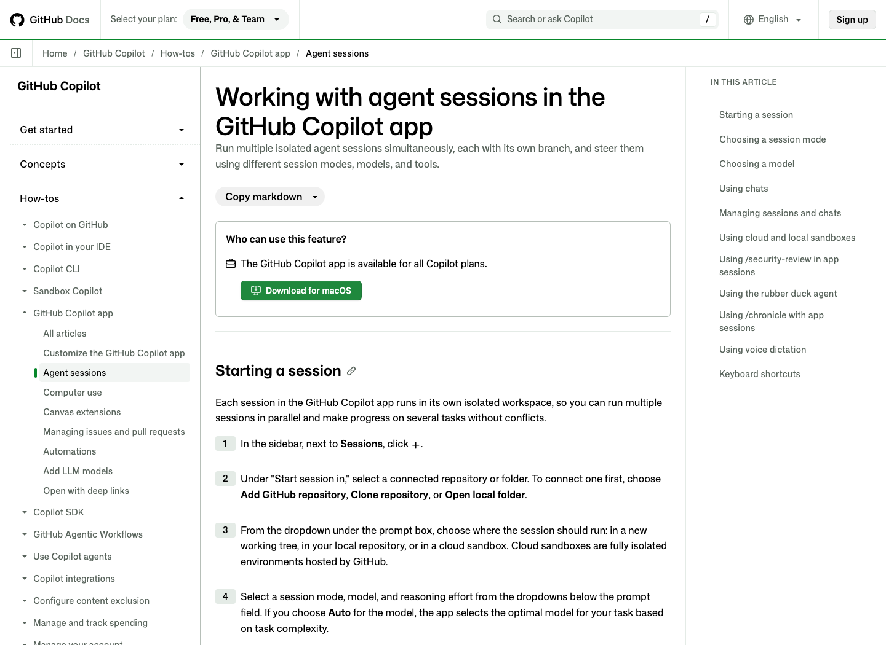
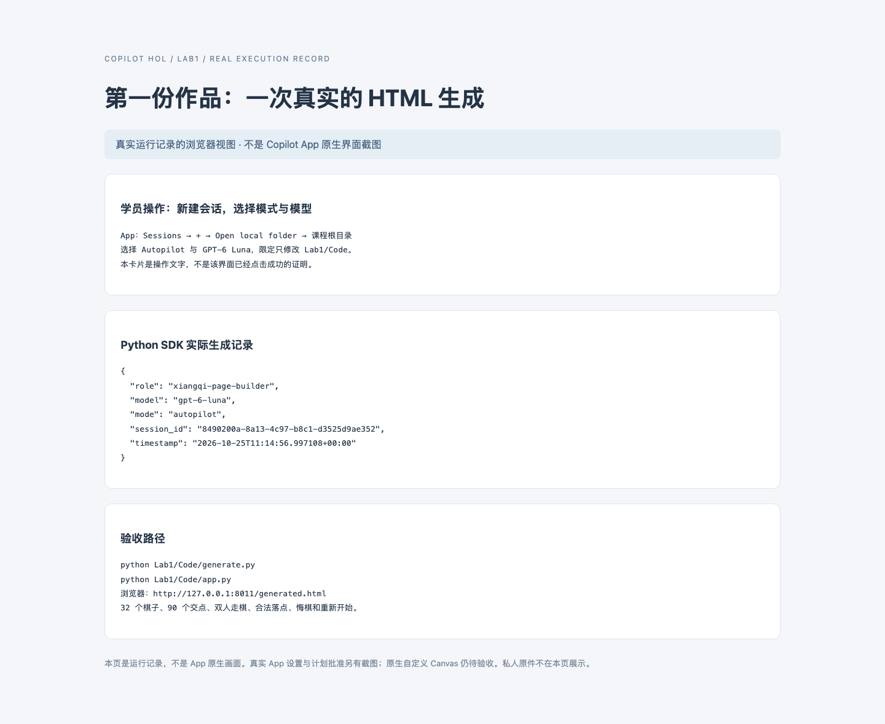
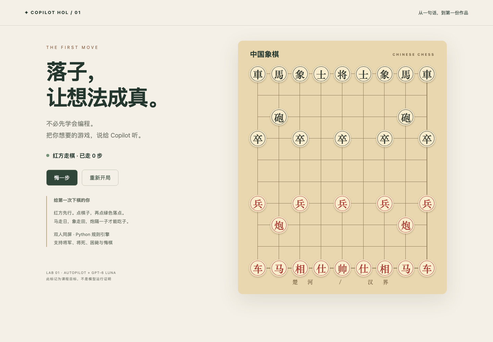
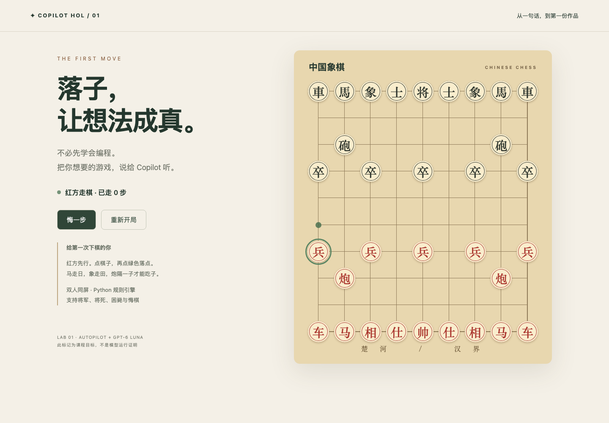
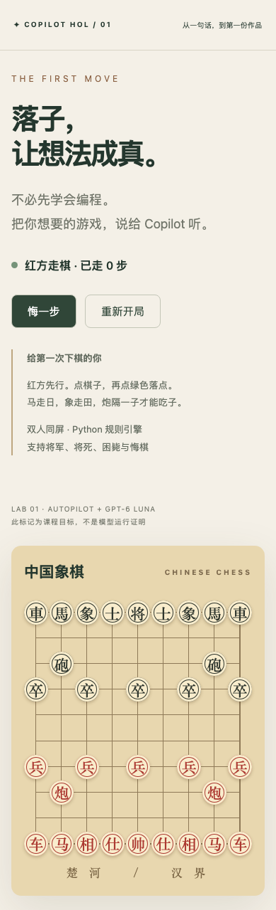

# Lab 1 · 第一份作品：楚河汉界

[简体中文](README.md) | [繁體中文](README.traditional.md)

**故事：** 工作室下周有一次团队活动。你想准备一个能在浏览器打开的中国象棋游戏，不想先学习一门编程语言。你的第一份需求不是“帮我写代码”，而是“帮同事玩起来，并且能证明规则没有乱来”。

预计 **35 分钟**。先完成 [根目录准备工作](../README.md#开始前只准备一次)，激活 Python 环境。**所有命令在课程根目录执行。**

## 作品和边界

本实验是双人同屏中国象棋，不是人机对战。支持红方先行、马腿、象眼、过河限制、炮架、将帅照面、不能送将、将死/困毙判负、悔棋和重开。不覆盖正式赛事中的长将、长捉与重复局面裁决。

业务规则在 `Code/xiangqi.py`；HTML 页面通过 Python 服务读取棋局。少量浏览器脚本只负责显示和点击，不在页面里另外维护一套走棋规则。

## 步骤 1 · 认识 App：把“聊天”变成“在文件夹里做事”

1. 在 GitHub Copilot App 的 **Sessions** 旁点击 **+**。
2. 选择 **Open local folder**，打开课程根目录，而不是只打开一张图片或 README。
3. 新会话命名为“我的第一盘棋”。确认这是本地文件夹会话。
4. 认识三个区域：左边找会话，中间描述需求，作品文件保存在本地 `Lab1/Code/`。

**检查：** 你能在文件管理器找到 `Lab1/Code/xiangqi.py`。本实验没有 Git 分支，不要把“新会话”误解为自动备份文件。

**配图是官方会话说明网页，已用 Playwright 截取，不是 App 自身的截图。**



## 步骤 2 · 选择 Autopilot 与 GPT-6 Luna，先讲清验收

在输入框下方选择 **Autopilot**，模型选择 **GPT-6 Luna**；也可先输入 `/autopilot` 切换模式，再检查模型选择器。不要选择 Auto 后直接认为已经使用 Luna。

复制这段需求：

```text
我在为非计算机专业同事做一个中国象棋小游戏。
只修改 Lab1/Code，不要创建子 Agent。
使用 Python 处理走棋规则，HTML/CSS/少量浏览器脚本展示。
页面中文，双人同屏，红方先走；点击棋子显示合法落点。
要支持马腿、象眼、炮架、将帅照面、不能送将、悔棋和重新开始。
不要先加人机对战、账户系统或数据库。
请先阅读现有代码，再完成和验证。结果要能通过 Playwright 实际点击。
```

**检查：** 模型选择器显示 Luna，模式显示 Autopilot。Autopilot 是连续执行方式，不是跳过所有权限与安全规则。

下面第一张是实际 App 新任务输入框，已显示 **Autopilot + GPT-6 Luna**，仅裁掉个人账户侧栏；第二张才是 SDK 的真实生成记录。设置截图不代替模型执行记录。




## 步骤 3 · 生成 HTML，并打开真正的作品

如果按课程参考实现复现，在已激活的终端依次运行：

```bash
python Lab1/Code/generate.py
python Lab1/Code/app.py
```

第一条通过 **Python Copilot SDK** 调用 `gpt-6-luna` 的 Autopilot 会话，生成 `Code/generated.html`；程序检查必要元素和本地脚本引用，不让生成结果破坏 Python 规则接口。

第二条启动服务。保持终端开启，在浏览器打开：

```text
http://127.0.0.1:8011/generated.html
```

**检查：** 看到中文页面、32 个棋子、红方先行。`Code/generation.json` 有真实模型、模式和会话记录。若 SDK 报错，停止修复；不要只看备用的 `/` 页面就声称生成成功。



## 步骤 4 · 验证“能看”之外，还“知道怎么走”

点击最左边红色“兵”（棋盘坐标 `0,6`）。绿色点应只在它正前方的空位 `0,5`，不能向后，也不能还没过河就横走。

坐标是方便讲师复核的标记：横向从左到右 0–8，纵向从上到下 0–9。学员只需要点击棋子。

**检查：** 只有一个合法落点。绿色落点来自 Python，不是随便画出的提示。



## 步骤 5 · 走出第一步，检查轮到谁

点击绿色落点，红兵向前走一步。看左侧状态，而不只是看棋子位置。

**检查：** 状态变为“黑方走棋 · 已走 1 步”。此时不能接着再走一枚红棋。你可以向 App 反馈：“请证明双方轮流走棋，而不只是棋子能拖动。”


## 步骤 6 · 用一次悔棋验证状态恢复

点击 **悔一步**，再试一次 **重新开局**。

**检查：** 悔棋后红兵回到原处、红方走棋、步数归零；重开后仍有 32 个棋子。尚未走棋就悔棋，应明确提示“还没有走棋”，而不是默默失败。


## 步骤 7 · 换一个屏幕，完成验收

在浏览器设备模式选择约 390 像素宽的手机，或让 App 用 Playwright 调整视口。确认没有横向滚动条，棋盘与按钮仍可使用。

在第二个终端（同样激活环境）运行：

```bash
python -m pytest -q tests/test_labs.py -k "initial_board or rules or horse or cannon or flying or crossed or stalemate"
```

**检查：** 规则测试通过；手机页面不横向溢出。结束后回到启动服务的终端，按 `Ctrl+C` 关闭服务。



## 你学到的不是“按一下就完成”

自然语言负责说明目标，Python 负责执行规则，Playwright 负责实际点击与截图。模型生成页面以后，仍然需要检查用户能不能完成操作。

**交付文件：** `Code/generated.html`、`Code/xiangqi.py`、`Code/app.py`、`Code/generation.json`，以及本目录截图。完整自动复核可在课程根目录运行 `python tools/verify.py`。

**排错：** 地址打不开时先看启动终端；端口被占用时不要关闭不认识的进程；确认没有重复启动自己的实验服务。模型列表没有 Luna 时先修复账号权限。App 原生新建会话与模型选择的实机配图仍在待补验收清单中。
