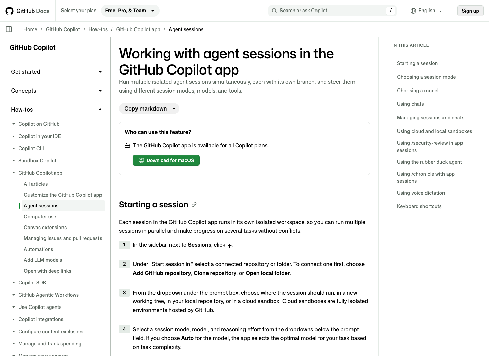
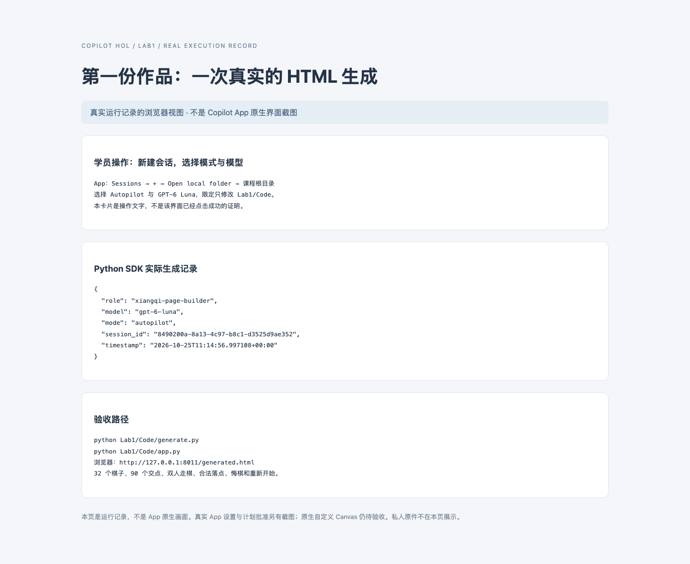
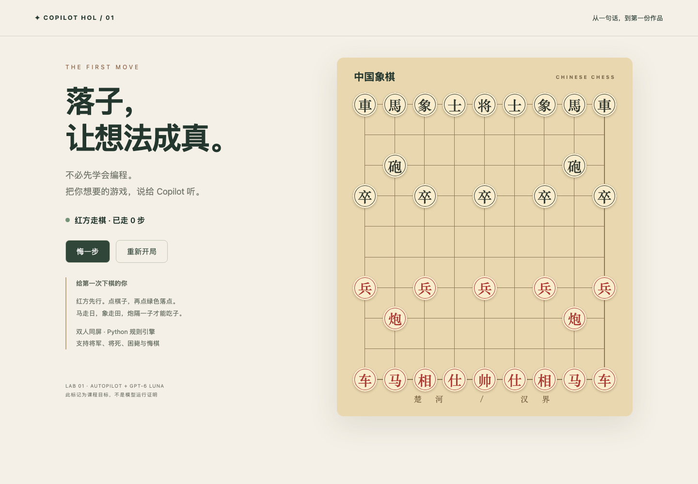
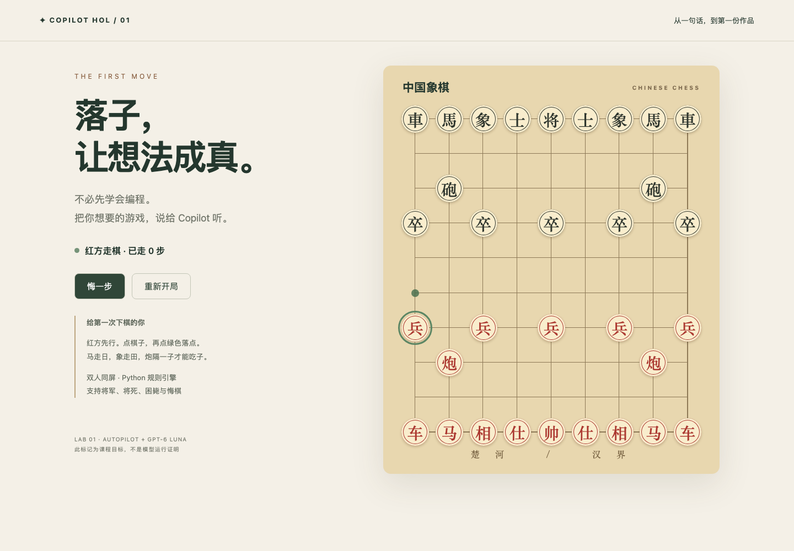
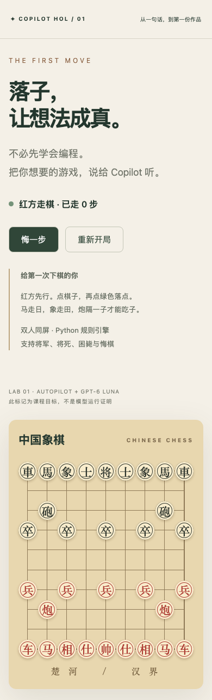

# Lab 1 · 第一份作品：楚河漢界

本文件使用繁體中文；課程程式、介面與教學截圖沿用原版，畫面文字可能為簡體中文，請對照實際介面操作。

[簡體中文](README.md) | [繁體中文](README.traditional.md)

**故事：** 工作室下週有一次團隊活動。你想準備一個能在瀏覽器開啟的中國象棋遊戲，不想先學習一門程式語言。你的第一份需求不是“幫我寫程式碼”，而是“幫同事玩起來，並且能證明規則沒有亂來”。

預計 **35 分鐘**。先完成 [根目錄準備工作](../README.traditional.md#開始前只準備一次)，啟用 Python 環境。**所有命令在課程根目錄執行。**

## 作品和邊界

本實驗是雙人同屏中國象棋，不是人機對戰。支援紅方先行、馬腿、象眼、過河限制、炮架、將帥照面、不能送將、將死/困斃判負、悔棋和重開。不覆蓋正式賽事中的長將、長捉與重複局面裁決。

業務規則在 `Code/xiangqi.py`；HTML 頁面通過 Python 服務讀取棋局。少量瀏覽器腳本只負責顯示和點擊，不在頁面裡另外維護一套走棋規則。

## 步驟 1 · 認識 App：把“聊天”變成“在資料夾裡做事”

1. 在 GitHub Copilot App 的 **Sessions** 旁點擊 **+**。
2. 選擇 **Open local folder**，開啟課程根目錄，而不是只開啟一張圖片或 README。
3. 新會話命名為“我的第一盤棋”。確認這是本地資料夾會話。
4. 認識三個區域：左邊找會話，中間描述需求，作品檔案儲存在本地 `Lab1/Code/`。

**檢查：** 你能在檔案管理器找到 `Lab1/Code/xiangqi.py`。本實驗沒有 Git 分支，不要把“新會話”誤解為自動備份檔案。

**配圖是官方會話說明網頁，已用 Playwright 擷取，不是 App 自身的截圖。**



## 步驟 2 · 選擇 Autopilot 與 GPT-6 Luna，先講清驗收

在輸入框下方選擇 **Autopilot**，模型選擇 **GPT-6 Luna**；也可先輸入 `/autopilot` 切換模式，再檢查模型選擇器。不要選擇 Auto 後直接認為已經使用 Luna。

複製這段需求：

```text
我在為非資訊相關科系同事做一個中國象棋小遊戲。
只修改 Lab1/Code，不要建立子 Agent。
使用 Python 處理走棋規則，HTML/CSS/少量瀏覽器腳本展示。
頁面中文，雙人同屏，紅方先走；點擊棋子顯示合法落點。
要支援馬腿、象眼、炮架、將帥照面、不能送將、悔棋和重新開始。
不要先加人機對戰、帳戶系統或資料庫。
請先閱讀現有程式碼，再完成和驗證。結果要能通過 Playwright 實際點擊。
```

**檢查：** 模型選擇器顯示 Luna，模式顯示 Autopilot。Autopilot 是連續執行方式，不是跳過所有權限與安全規則。

下面第一張是實際 App 新任務輸入框，已顯示 **Autopilot + GPT-6 Luna**，僅裁掉個人帳戶側欄；第二張才是 SDK 的真實生成記錄。設定截圖不代替模型執行記錄。




## 步驟 3 · 生成 HTML，並開啟真正的作品

如果按課程參考實現復現，在已啟用的終端依次執行：

```bash
python Lab1/Code/generate.py
python Lab1/Code/app.py
```

第一條通過 **Python Copilot SDK** 呼叫 `gpt-6-luna` 的 Autopilot 會話，生成 `Code/generated.html`；程式檢查必要元素和本地腳本引用，不讓生成結果破壞 Python 規則介面。

第二條啟動服務。保持終端開啟，在瀏覽器開啟：

```text
http://127.0.0.1:8011/generated.html
```

**檢查：** 看到中文頁面、32 個棋子、紅方先行。`Code/generation.json` 有真實模型、模式和會話記錄。若 SDK 報錯，停止修復；不要只看備用的 `/` 頁面就聲稱生成成功。



## 步驟 4 · 驗證“能看”之外，還“知道怎麼走”

點擊最左邊紅色“兵”（棋盤座標 `0,6`）。綠色點應只在它正前方的空位 `0,5`，不能向後，也不能還沒過河就橫走。

座標是方便講師複核的標記：橫向從左到右 0–8，縱向從上到下 0–9。學員只需要點擊棋子。

**檢查：** 只有一個合法落點。綠色落點來自 Python，不是隨便畫出的提示。



## 步驟 5 · 走出第一步，檢查輪到誰

點擊綠色落點，紅兵向前走一步。看左側狀態，而不只是看棋子位置。

**檢查：** 狀態變為“黑方走棋 · 已走 1 步”。此時不能接著再走一枚紅棋。你可以向 App 反饋：“請證明雙方輪流走棋，而不只是棋子能拖動。”


## 步驟 6 · 用一次悔棋驗證狀態恢復

點擊 **悔一步**，再試一次 **重新開局**。

**檢查：** 悔棋後紅兵回到原處、紅方走棋、步數歸零；重開後仍有 32 個棋子。尚未走棋就悔棋，應明確提示“還沒有走棋”，而不是默默失敗。


## 步驟 7 · 換一個螢幕，完成驗收

在瀏覽器裝置模式選擇約 390 像素寬的手機，或讓 App 用 Playwright 調整檢視區。確認沒有橫向捲軸，棋盤與按鈕仍可使用。

在第二個終端（同樣啟用環境）執行：

```bash
python -m pytest -q tests/test_labs.py -k "initial_board or rules or horse or cannon or flying or crossed or stalemate"
```

**檢查：** 規則測試通過；手機頁面不橫向溢位。結束後回到啟動服務的終端，按 `Ctrl+C` 關閉服務。



## 你學到的不是“按一下就完成”

自然語言負責說明目標，Python 負責執行規則，Playwright 負責實際點擊與截圖。模型生成頁面以後，仍然需要檢查使用者能不能完成操作。

**交付檔案：** `Code/generated.html`、`Code/xiangqi.py`、`Code/app.py`、`Code/generation.json`，以及本目錄截圖。完整自動複核可在課程根目錄執行 `python tools/verify.py`。

**排錯：** 地址打不開時先看啟動終端；連接埠被佔用時不要關閉不認識的程序；確認沒有重複啟動自己的實驗服務。模型列表沒有 Luna 時先修復帳號權限。App 原生新建會話與模型選擇的實機配圖仍在待補驗收清單中。
