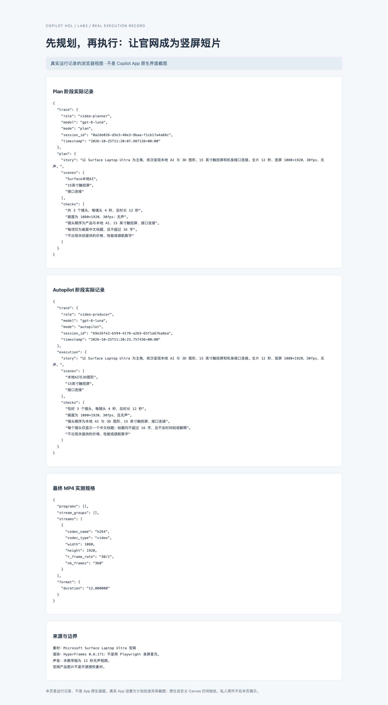
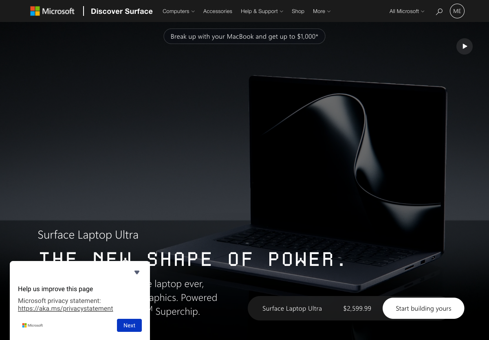
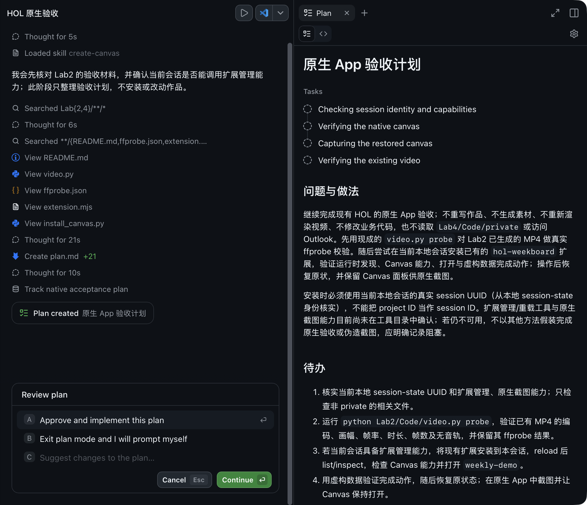
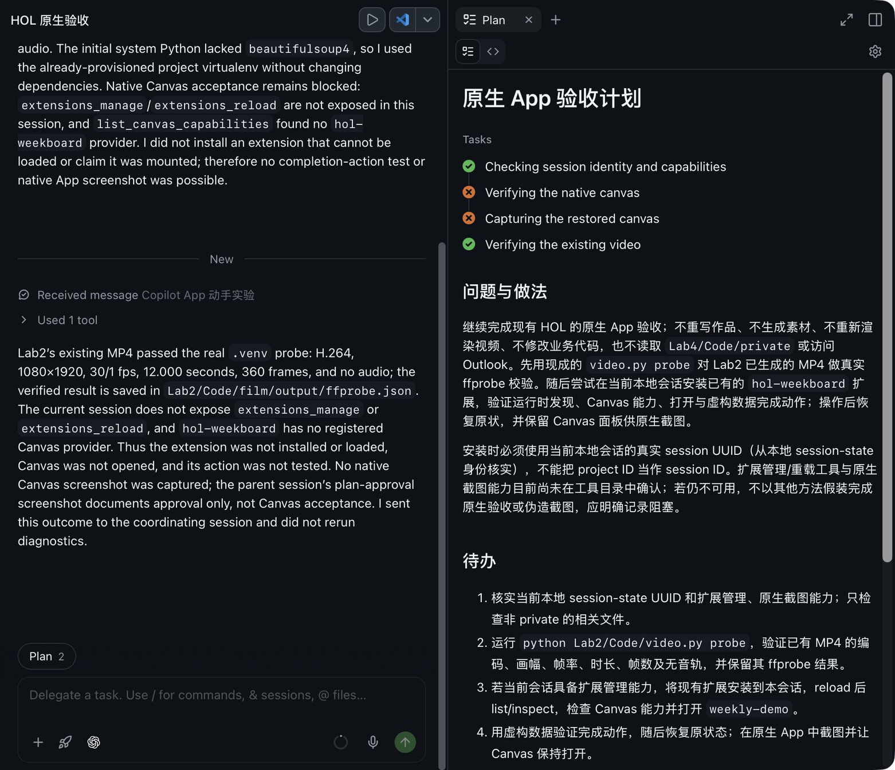
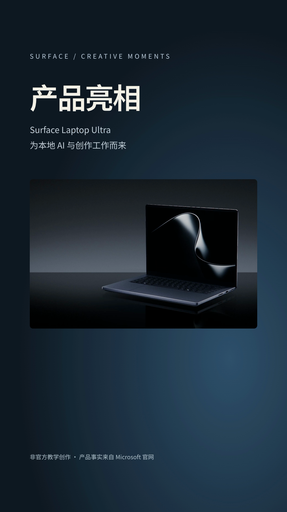
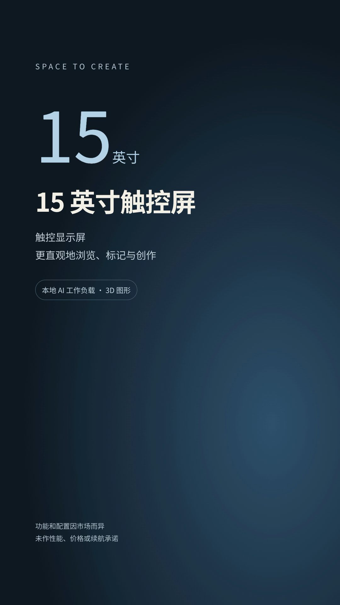
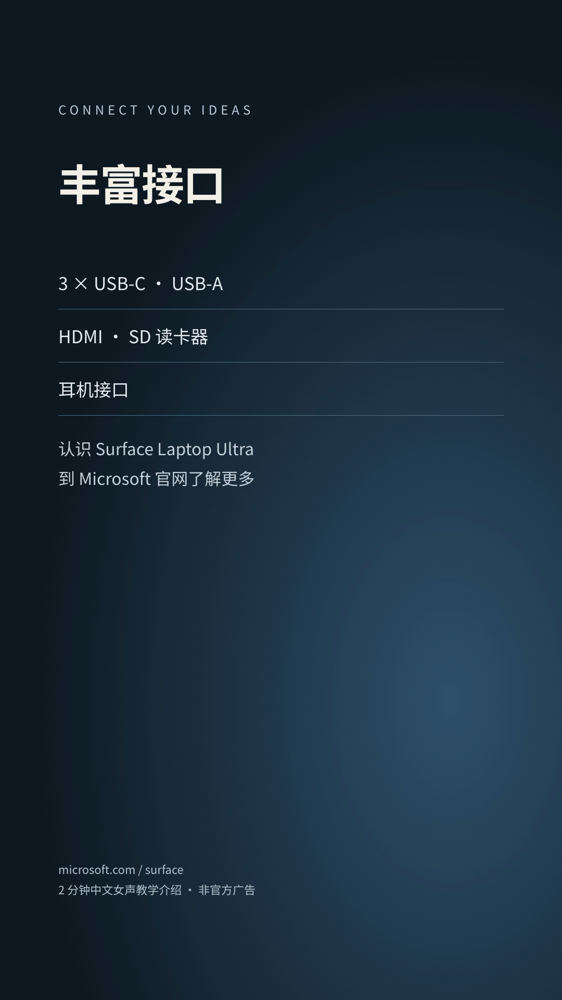

# Lab 2 · 产品故事：用 CLI 把官网变成竖屏视频

[简体中文](README.md) | [繁體中文](README.traditional.md)

**故事：** 小游戏赢得了同事的兴趣。接下来，工作室请你为 Surface Laptop Ultra 做一段适合手机观看的产品短片。你不负责发明产品参数，而是把有来源的事实讲清楚。

预计 **45 分钟**。按照最终要求，本 Lab **只生成 HyperFrames 脚本和视频，不构建额外网页、播放界面或产品管理界面**。Python 负责模型调用、资料准备与规格核验；真正的渲染由 **HyperFrames CLI** 完成。

**目标：** `1080×1920`、`9:16`、`30fps`、`120 秒`，共 6 个各 20 秒的镜头；使用 `edge-tts` 的晓晓普通话女声合成旁白，并导出字幕文件。模型为 GPT-6 Luna，工作方式为 **Plan → 审阅 → Autopilot**。

所有命令默认在课程根目录执行；步骤 5 会明确进入 `film` 目录。

## 步骤 1 · 把任务交给“导演”，而不是立即开工

在 App 新建本地会话，选择 **Plan** 和 **GPT-6 Luna**。输入：

```text
请先规划，不要执行。
仅修改 Lab2 和根目录的 requirements.txt。基于 Microsoft 的 Surface Laptop Ultra 官网，
用 HyperFrames CLI 制作 2 分钟、1080×1920、30fps 的竖屏产品介绍。
共 6 个镜头、每个 20 秒，加入 edge-tts 的 zh-CN-XiaoxiaoNeural 普通话女声旁白。
先给我分镜、来源核对、需要下载的素材、旁白脚本与命令行执行步骤和验收标准。
不要制作播放网页或额外界面，不要添加未经核实的价格、续航或性能数字。
```

**检查：** 此时得到的是方案，不是最终视频。你应能回答“给谁看、几个镜头、使用哪些事实、最后如何验证”。

配图为实际 Plan 与 Autopilot 的 SDK 记录。步骤 3 另附后续原生验收会话的真实计划批准面板；不要把后续验收计划说成最初的分镜生成计划。



## 步骤 2 · 把官网当作资料，不当作模型的想象空间

打开指定 [Surface Laptop Ultra 官网](https://www.microsoft.com/en-us/surface/devices/surface-laptop-ultra)。核对产品名称、15 英寸触控屏与接口信息。官网变化时应重新核对，不沿用旧截图断言最新配置。

课程素材中保留了页面 URL、获取时间和哈希；产品图片直接取自该官网，**不是用生成式图像画的假产品**。图片为 Microsoft 资产，不因放进教学包就获得开源授权；对外商业发布前请另行检查使用权。

```bash
python tools/fetch_sources.py
```

**检查：** `Lab2/Code/data/source.json` 和 `facts.json` 存在。该命令也更新 Lab 3 的公开财报表格，不访问私人数据。



## 步骤 3 · 批准方案，再切换 Autopilot

检查 Plan 输出：总时长 120 秒，画面是 9:16，旁白分为 6 段与镜头对应，只使用已核实事实，不请求发布到社交平台。

在 App 批准方案并切换 **Autopilot**，仍保持 **GPT-6 Luna**，发送：

```text
批准这份计划。请生成 2 分钟普通话女声口播稿与可编辑的 HyperFrames 分镜，
用 edge-tts 的 zh-CN-XiaoxiaoNeural 从文本脚本合成旁白，并通过 CLI 导出带音轨 MP4。
共 6 个 20 秒镜头。不要制作额外界面。完成后检查真实视频的尺寸、时长、帧率和音轨，
并解码实际 MP4 的镜头截图，不能用 HTML 预览截图冒充成片。
```

参考实现的等价 Python SDK 复现命令：

```bash
python Lab2/Code/story.py
```

这会保存真实 Plan 与 Autopilot 输出到 `Code/data/story.json`。脚本中的自动批准只针对本课程公开资料；课堂 App 操作应由学员先审阅计划，不能把自动批准误认为真人已经点击批准。

**检查：** `plan_trace.mode` 为 `plan`，`trace.mode` 为 `autopilot`，两者的 `model` 都是 `gpt-6-luna`。六个标题写入镜头变量；六段口播稿写入 `data/narration.txt`，随后由 edge-tts 命令行合成音频。


以下是本次制作中另外完成的**原生验收计划**：先在 Plan 检查现有视频，再批准进入 Autopilot 运行 `probe`。截图能证明原生计划审阅与批准流程，但不是最初创作分镜的历史截图。验收计划还尝试 Canvas；截图中 Canvas 的未通过状态没有被隐藏。





## 步骤 4 · 准备渲染器和脚本

业务编排、口播稿和 edge-tts 都由 Python 命令行驱动；HyperFrames 负责渲染。先安装 Python 依赖（包含固定版本 edge-tts），再安装官方渲染器依赖：

```bash
python -m pip install -r requirements.txt --index-url https://packagefeedproxy.microsoft.io/pypi/simple/
npm ci --prefix Lab2/Code --ignore-scripts --no-audit --no-fund --registry=https://packagefeedproxy.microsoft.io/npm/
python Lab2/Code/story.py
python Lab2/Code/video.py prepare
python Lab2/Code/video.py voice
```

`story.py` 生成 Plan、六个镜头标题和与事实对应的普通话口播稿。`prepare` 下载官网产品图、带授权文件的 Noto Sans SC 字体，复制固定版本 GSAP，并把标题写入镜头。章节模板会按每个镜头生成独立、已填入正文的组合，避免复用组件时章节内容互相覆盖。`voice` 通过 edge-tts 命令行使用 `zh-CN-XiaoxiaoNeural`（普通话女声“晓晓”），生成 MP3 和 SRT。

等价的 edge-tts 命令为：

```bash
python -m edge_tts --file Lab2/Code/data/narration.txt --voice zh-CN-XiaoxiaoNeural --rate=-5% \
  --write-media Lab2/Code/film/assets/narration.mp3 \
  --write-subtitles Lab2/Code/film/assets/narration.srt
```

脚本位置：

```text
Lab2/Code/film/index.html
Lab2/Code/film/compositions/opening.html
Lab2/Code/film/compositions/chapter.html（模板）
Lab2/Code/film/compositions/chapter-ai.html（prepare 生成）
Lab2/Code/film/compositions/chapter-workflow.html（prepare 生成）
Lab2/Code/film/compositions/chapter-repair.html（prepare 生成）
Lab2/Code/film/compositions/display.html
Lab2/Code/film/compositions/connections.html
```

**检查：** 根脚本是 `1080×1920`、总时长 120；六个镜头起点为 0、20、40、60、80、100 秒，各自独立。旁白脚本分为六段，每段与对应镜头匹配。不要用普通网页 `setTimeout` 或随机动画代替可逐帧定位的动画。

下图是这套脚本导出的**真实第一镜头成片**，不是另做的产品网页：



## 步骤 5 · 直接运行 HyperFrames CLI

在终端依次执行：

```bash
cd Lab2/Code/film
npx --no-install hyperframes browser ensure
npx --no-install hyperframes check --json
npx --no-install hyperframes render --quality delivery --fps 30 --output output/surface-ultra.mp4
cd ../../..
```

**检查：** `check` 返回 `"ok": true`，不能把 `browserSkipped:true` 或只跑了静态检查当作完整通过；`render` 显示完成并产生非空 MP4。视频应包含中文女声旁白。任何命令报错就先修复，不跳到下一步。

不需要搭建播放页面。直接用系统播放器打开：

```text
Lab2/Code/film/output/surface-ultra.mp4
```


## 步骤 6 · 验收的是视频文件，不是漂亮预览

回到课程根目录：

```bash
python Lab2/Code/video.py probe
```

该命令调用 `ffprobe`，把结果保存到 `film/output/ffprobe.json`。通过条件是：

| 项目 | 要求 |
|---|---|
| 视频编码 | H.264 |
| 宽 × 高 | 1080 × 1920，竖屏 9:16 |
| 帧率 | 30/1 |
| 时长 | 120.000 秒，容差 0.1 秒 |
| 帧数 | 3600 |
| 声音 | 有 edge-tts 普通话女声旁白，时长 110–120 秒 |

再在播放器分别查看 10、30、50、70、90、110 秒，并听取旁白。确认有文字、产品图、中文字体、六个主题和清晰中文女声；只有“文件存在”或“尺寸正确”还不够。

本课程截图由 FFmpeg **解码最终 MP4**，不使用 HTML 预览截图冒充成片。用 `ffmpeg -v error -i Lab2/Code/film/output/surface-ultra.mp4 -f null -` 检查完整视频的 3600 帧均可解码。







## 排错与交付

中文方块：检查 `film/assets/NotoSansSC.ttf` 与 `@font-face`，不要只依赖讲师电脑的系统字体。画面开头为空：先跳到 1.5 秒再判断，因为入场动画从透明开始。整个镜头为空：检查 composition ID、timeline key 和镜头时长是否一致。

**最终交付：** `film/` 下的可编辑脚本、素材来源、`assets/narration.mp3`、`assets/narration.srt`、`output/surface-ultra.mp4`、`ffprobe.json` 和真实成片截图。`data/story.json` 记录模型参与，`data/narration.txt` 保存合成脚本，不需要额外搭建任何界面。
