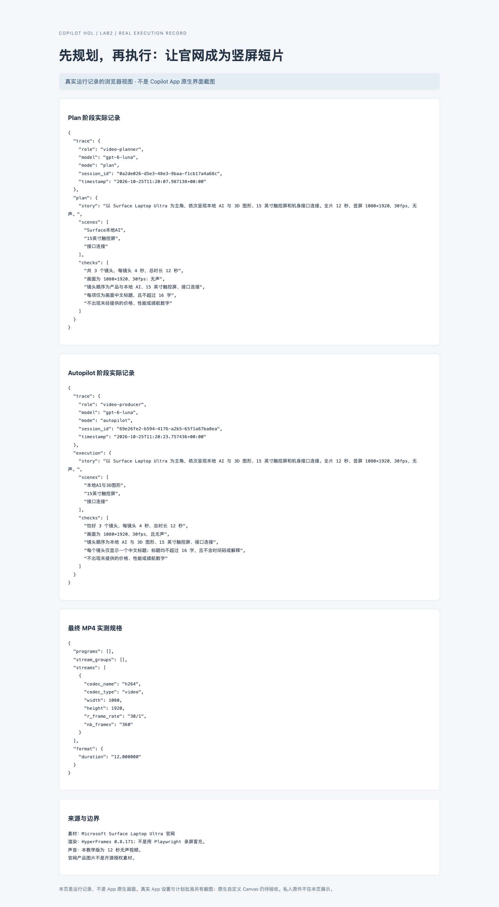
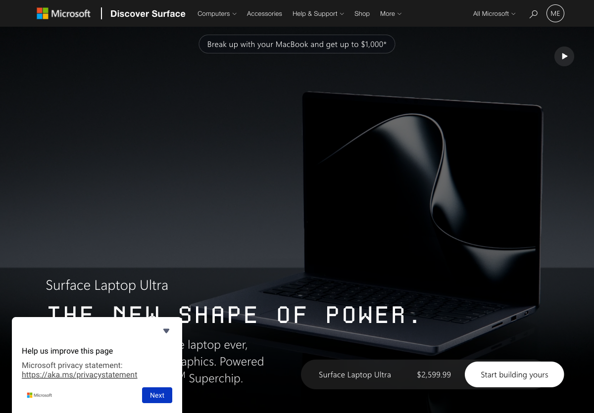
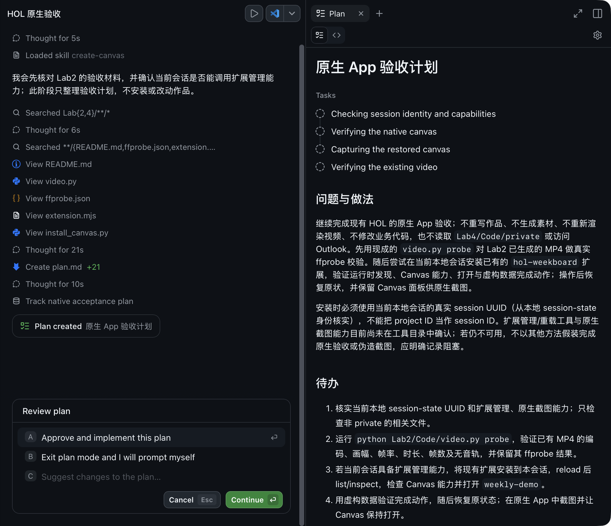
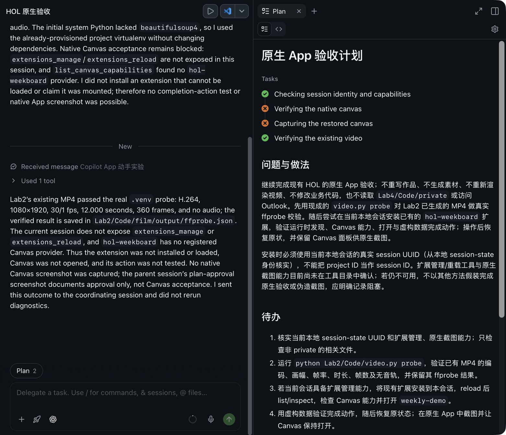
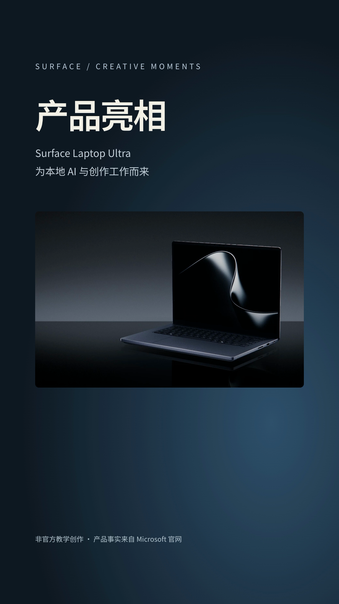
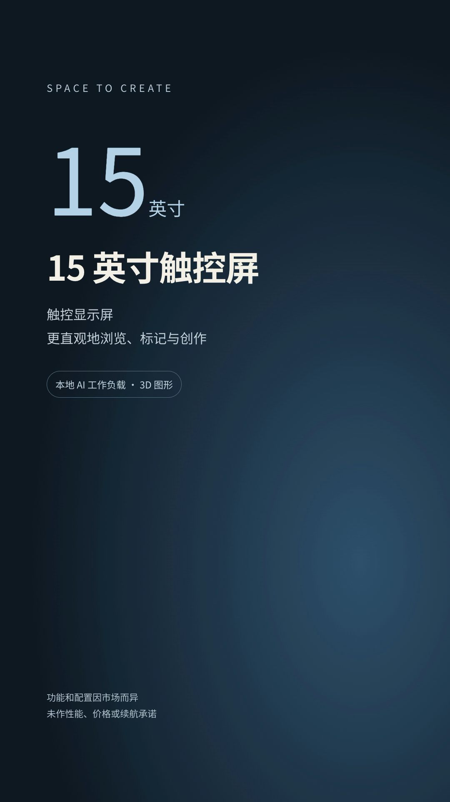
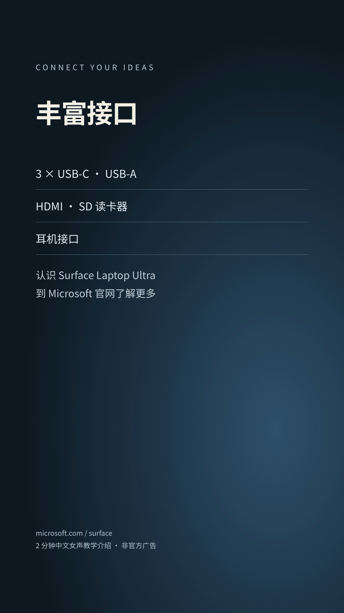

# Lab 2 · 產品故事：用 CLI 把官網變成直式影片

本文件使用繁體中文；課程程式、介面與教學截圖沿用原版，畫面文字可能為簡體中文，請對照實際介面操作。

[簡體中文](README.md) | [繁體中文](README.traditional.md)

**故事：** 小遊戲贏得了同事的興趣。接下來，工作室請你為 Surface Laptop Ultra 做一段適合手機觀看的產品短片。你不負責發明產品參數，而是把有來源的事實講清楚。

預計 **45 分鐘**。按照最終要求，本 Lab **只生成 HyperFrames 腳本和影片，不構建額外網頁、播放介面或產品管理介面**。Python 負責模型呼叫、資料準備與規格核驗；真正的渲染由 **HyperFrames CLI** 完成。

**目標：** `1080×1920`、`9:16`、`30fps`、`120 秒`，共 6 個各 20 秒的鏡頭；使用 `edge-tts` 的曉曉普通話女聲合成旁白，並匯出字幕檔案。模型為 GPT-6 Luna，工作方式為 **Plan → 審閱 → Autopilot**。

所有命令預設在課程根目錄執行；步驟 5 會明確進入 `film` 目錄。

## 步驟 1 · 把任務交給“導演”，而不是立即開工

在 App 新建本地會話，選擇 **Plan** 和 **GPT-6 Luna**。輸入：

```text
請先規劃，不要執行。
僅修改 Lab2 和根目錄的 requirements.txt。基於 Microsoft 的 Surface Laptop Ultra 官網，
用 HyperFrames CLI 製作 2 分鐘、1080×1920、30fps 的直式產品介紹。
共 6 個鏡頭、每個 20 秒，加入 edge-tts 的 zh-CN-XiaoxiaoNeural 普通話女聲旁白。
先給我分鏡、來源核對、需要下載的素材、旁白腳本與命令列執行步驟和驗收標準。
不要製作播放網頁或額外介面，不要新增未經核實的價格、續航或效能數字。
```

**檢查：** 此時得到的是方案，不是最終影片。你應能回答“給誰看、幾個鏡頭、使用哪些事實、最後如何驗證”。

配圖為實際 Plan 與 Autopilot 的 SDK 記錄。步驟 3 另附後續原生驗收會話的真實計劃批准面板；不要把後續驗收計劃說成最初的分鏡生成計劃。



## 步驟 2 · 把官網當作資料，不當作模型的想像空間

開啟指定 [Surface Laptop Ultra 官網](https://www.microsoft.com/en-us/surface/devices/surface-laptop-ultra)。核對產品名稱、15 吋觸控螢幕與介面資訊。官網變化時應重新核對，不沿用舊截圖斷言最新配置。

課程素材中保留了頁面 URL、獲取時間和雜湊；產品圖片直接取自該官網，**不是用生成式影像畫的假產品**。圖片為 Microsoft 資產，不因放進教學包就獲得開源授權；對外商業釋出前請另行檢查使用權。

```bash
python tools/fetch_sources.py
```

**檢查：** `Lab2/Code/data/source.json` 和 `facts.json` 存在。該命令也更新 Lab 3 的公開財報表格，不訪問私人資料。



## 步驟 3 · 批准方案，再切換 Autopilot

檢查 Plan 輸出：總時長 120 秒，畫面是 9:16，旁白分為 6 段與鏡頭對應，只使用已核實事實，不請求釋出到社交平臺。

在 App 批准方案並切換 **Autopilot**，仍保持 **GPT-6 Luna**，傳送：

```text
批准這份計劃。請生成 2 分鐘普通話女聲口播稿與可編輯的 HyperFrames 分鏡，
用 edge-tts 的 zh-CN-XiaoxiaoNeural 從文字腳本合成旁白，並通過 CLI 匯出帶音軌 MP4。
共 6 個 20 秒鏡頭。不要製作額外介面。完成後檢查真實影片的尺寸、時長、幀率和音軌，
並解碼實際 MP4 的鏡頭截圖，不能用 HTML 預覽截圖冒充成片。
```

參考實現的等價 Python SDK 復現命令：

```bash
python Lab2/Code/story.py
```

這會儲存真實 Plan 與 Autopilot 輸出到 `Code/data/story.json`。腳本中的自動批准只針對本課程公開資料；課堂 App 操作應由學員先審閱計劃，不能把自動批准誤認為真人已經點擊批准。

**檢查：** `plan_trace.mode` 為 `plan`，`trace.mode` 為 `autopilot`，兩者的 `model` 都是 `gpt-6-luna`。六個標題寫入鏡頭變數；六段口播稿寫入 `data/narration.txt`，隨後由 edge-tts 命令列合成音訊。


以下是本次製作中另外完成的**原生驗收計劃**：先在 Plan 檢查現有影片，再批准進入 Autopilot 執行 `probe`。截圖能證明原生計劃審閱與批准流程，但不是最初創作分鏡的歷史截圖。驗收計劃還嘗試 Canvas；截圖中 Canvas 的未通過狀態沒有被隱藏。





## 步驟 4 · 準備渲染器和腳本

業務編排、口播稿和 edge-tts 都由 Python 命令列驅動；HyperFrames 負責渲染。先安裝 Python 依賴（包含固定版本 edge-tts），再安裝官方渲染器依賴：

```bash
python -m pip install -r requirements.txt --index-url https://packagefeedproxy.microsoft.io/pypi/simple/
npm ci --prefix Lab2/Code --ignore-scripts --no-audit --no-fund --registry=https://packagefeedproxy.microsoft.io/npm/
python Lab2/Code/story.py
python Lab2/Code/video.py prepare
python Lab2/Code/video.py voice
```

`story.py` 生成 Plan、六個鏡頭標題和與事實對應的普通話口播稿。`prepare` 下載官網產品圖、帶授權檔案的 Noto Sans SC 字型，複製固定版本 GSAP，並把標題寫入鏡頭。章節模板會按每個鏡頭生成獨立、已填入正文的組合，避免複用元件時章節內容互相覆蓋。`voice` 通過 edge-tts 命令列使用 `zh-CN-XiaoxiaoNeural`（普通話女聲“曉曉”），生成 MP3 和 SRT。

等價的 edge-tts 命令為：

```bash
python -m edge_tts --file Lab2/Code/data/narration.txt --voice zh-CN-XiaoxiaoNeural --rate=-5% \
  --write-media Lab2/Code/film/assets/narration.mp3 \
  --write-subtitles Lab2/Code/film/assets/narration.srt
```

腳本位置：

```text
Lab2/Code/film/index.html
Lab2/Code/film/compositions/opening.html
Lab2/Code/film/compositions/chapter.html（模板）
Lab2/Code/film/compositions/chapter-ai.html（prepare 生成）
Lab2/Code/film/compositions/chapter-workflow.html（prepare 生成）
Lab2/Code/film/compositions/chapter-repair.html（prepare 生成）
Lab2/Code/film/compositions/display.html
Lab2/Code/film/compositions/connections.html
```

**檢查：** 根腳本是 `1080×1920`、總時長 120；六個鏡頭起點為 0、20、40、60、80、100 秒，各自獨立。旁白腳本分為六段，每段與對應鏡頭匹配。不要用普通網頁 `setTimeout` 或隨機動畫代替可逐幀定位的動畫。

下圖是這套腳本匯出的**真實第一鏡頭成片**，不是另做的產品網頁：



## 步驟 5 · 直接執行 HyperFrames CLI

在終端依次執行：

```bash
cd Lab2/Code/film
npx --no-install hyperframes browser ensure
npx --no-install hyperframes check --json
npx --no-install hyperframes render --quality delivery --fps 30 --output output/surface-ultra.mp4
cd ../../..
```

**檢查：** `check` 返回 `"ok": true`，不能把 `browserSkipped:true` 或只跑了靜態檢查當作完整通過；`render` 顯示完成並產生非空 MP4。影片應包含中文女聲旁白。任何命令報錯就先修復，不跳到下一步。

不需要搭建播放頁面。直接用系統播放器開啟：

```text
Lab2/Code/film/output/surface-ultra.mp4
```


## 步驟 6 · 驗收的是影片檔案，不是漂亮預覽

回到課程根目錄：

```bash
python Lab2/Code/video.py probe
```

該命令呼叫 `ffprobe`，把結果儲存到 `film/output/ffprobe.json`。通過條件是：

| 專案 | 要求 |
|---|---|
| 影片編碼 | H.264 |
| 寬 × 高 | 1080 × 1920，直式 9:16 |
| 幀率 | 30/1 |
| 時長 | 120.000 秒，容差 0.1 秒 |
| 幀數 | 3600 |
| 聲音 | 有 edge-tts 普通話女聲旁白，時長 110–120 秒 |

再在播放器分別檢視 10、30、50、70、90、110 秒，並聽取旁白。確認有文字、產品圖、中文字型、六個主題和清晰中文女聲；只有“檔案存在”或“尺寸正確”還不夠。

本課程截圖由 FFmpeg **解碼最終 MP4**，不使用 HTML 預覽截圖冒充成片。用 `ffmpeg -v error -i Lab2/Code/film/output/surface-ultra.mp4 -f null -` 檢查完整影片的 3600 幀均可解碼。







## 排錯與交付

中文方塊：檢查 `film/assets/NotoSansSC.ttf` 與 `@font-face`，不要只依賴講師電腦的系統字型。畫面開頭為空：先跳到 1.5 秒再判斷，因為入場動畫從透明開始。整個鏡頭為空：檢查 composition ID、timeline key 和鏡頭時長是否一致。

**最終交付：** `film/` 下的可編輯腳本、素材來源、`assets/narration.mp3`、`assets/narration.srt`、`output/surface-ultra.mp4`、`ffprobe.json` 和真實成片截圖。`data/story.json` 記錄模型參與，`data/narration.txt` 儲存合成腳本，不需要額外搭建任何介面。
