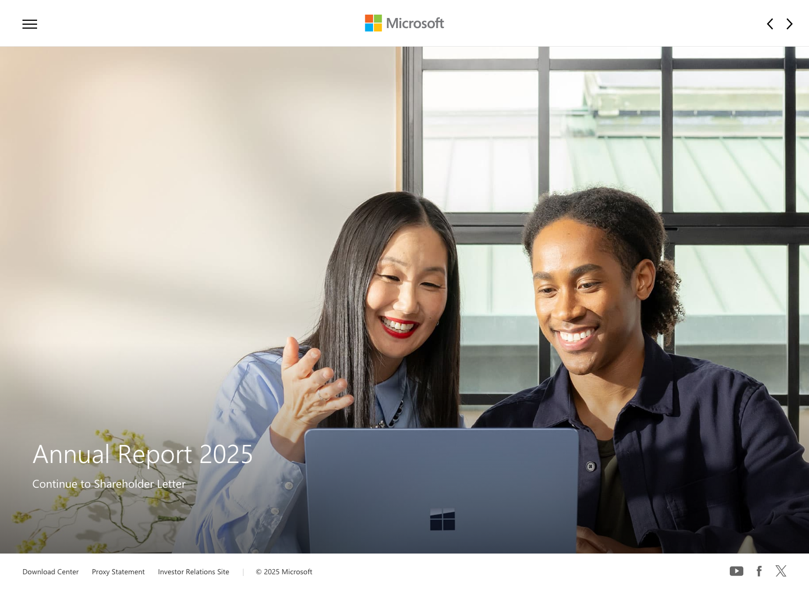
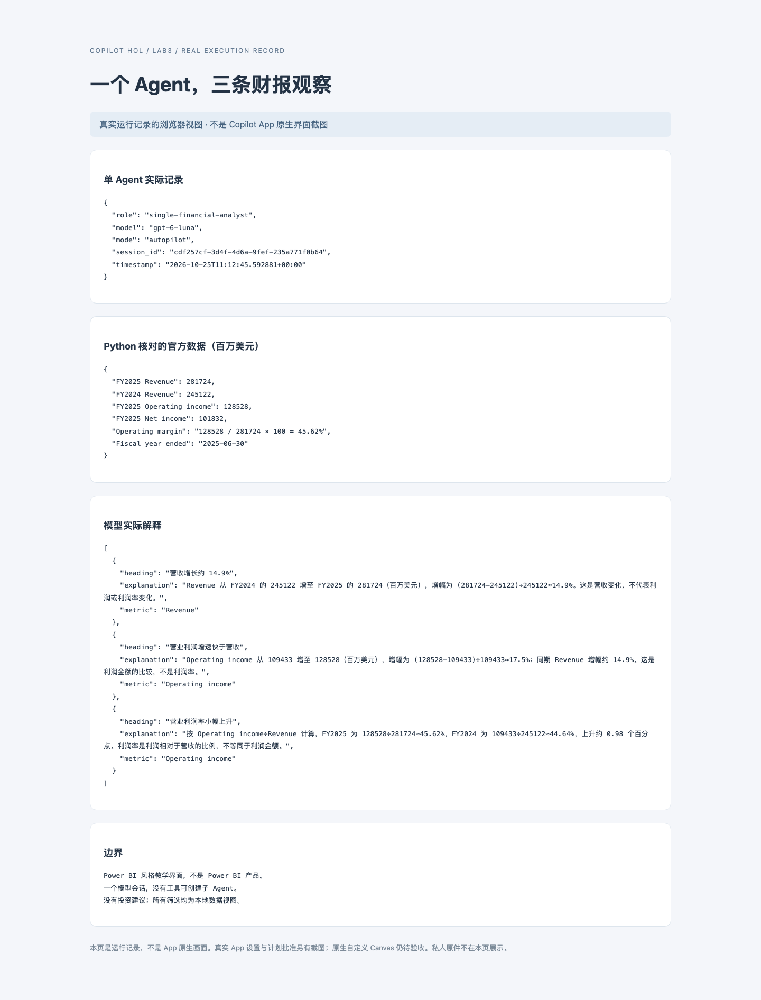
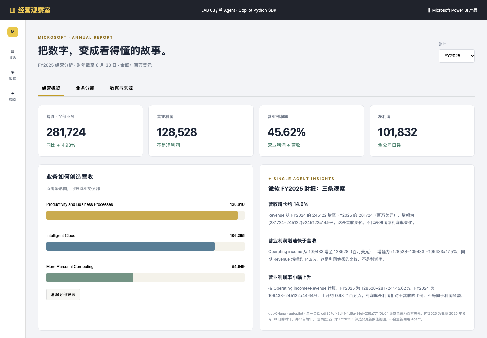
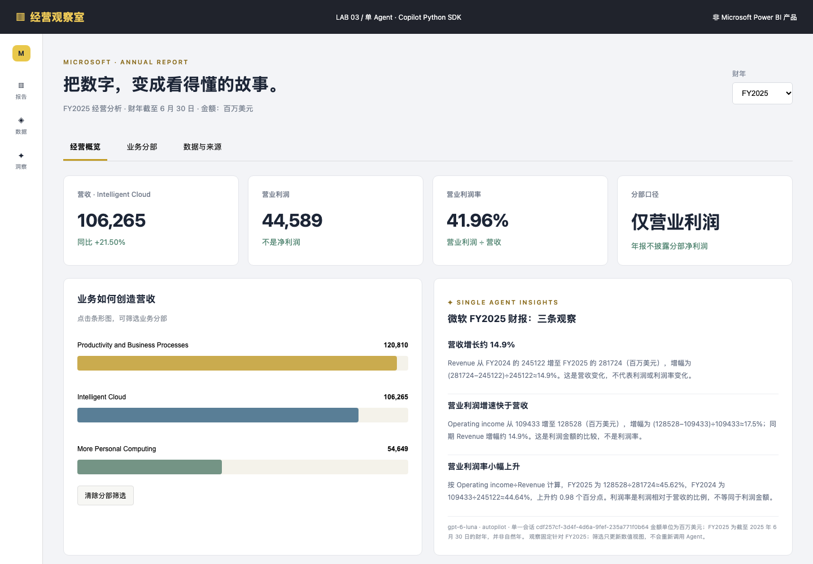
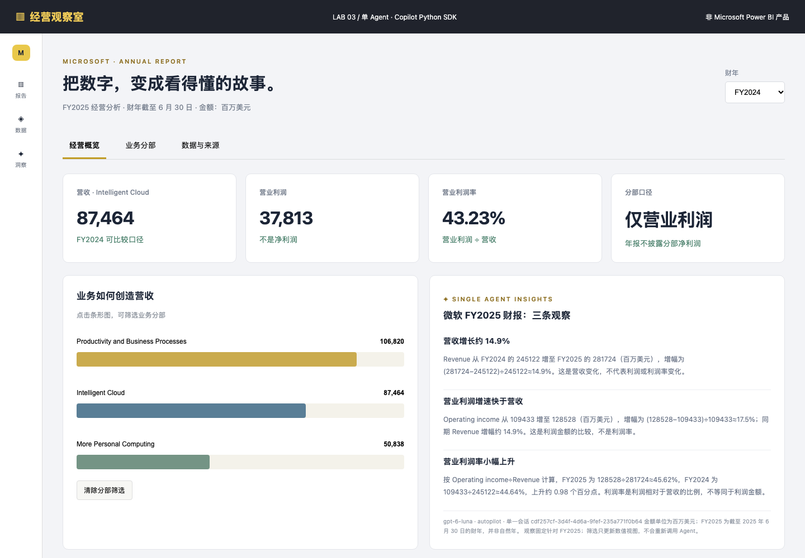
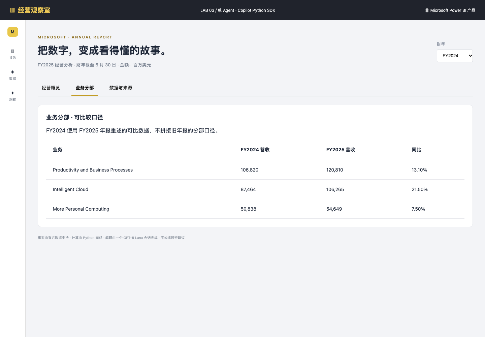
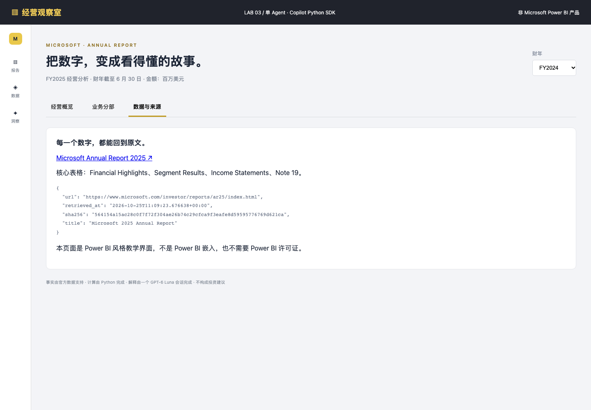

# Lab 3 · 经营观察室：让一个 Agent 讲清一份财报

[简体中文](README.md) | [繁體中文](README.traditional.md)

**故事：** 产品短片做完了，同事问：“微软的业务到底怎么样？”你不想把整份年报复制到聊天窗口，也不想凭模型印象回答。你要做一个像 Power BI 一样易读的经营观察室，让每个数字都能回到原文。

预计 **45 分钟**。**本 Lab 保留 Power BI 风格界面**，使用 Python Copilot SDK 的**一个 Agent**分析，不使用多 Agent，不用 HyperFrames 替换界面。模型是 **GPT-6 Luna**，模式是 **Autopilot**。

所有命令在课程根目录执行，先激活 Python 环境。页面只是教学作品，不是 Power BI 服务，也不需要 Power BI 许可证。

## 步骤 1 · 先确认“讲的是哪一年、什么口径”

打开指定的 [Microsoft Annual Report 2025](https://www.microsoft.com/investor/reports/ar25/index.html)。

找到 Financial Highlights、Income Statements 和 Segment Results / Note 19。FY2025 是**截至 2025 年 6 月 30 日的财年**，不是 2025 自然年；表格金额通常为**百万美元**，不要混成美元、亿元或十亿美元。

```bash
python tools/fetch_sources.py
python Lab3/Code/finance.py
```

第一条从官方页面提取相关表格并保存来源信息，第二条打印 Python 解析结果。已经随课程附带本次实际获取的表格快照，断网时可先查看；如果重新抓取失败，不用假数据覆盖快照。

**检查：** FY2025 营收 `281724`、营业利润 `128528`、净利润 `101832`，单位均为百万美元。2024 分部对比采用本份 2025 年报列示的重述数据。



## 步骤 2 · 在 App 规定“一个 Agent 就够了”

新建本地会话，打开课程根目录，选择 **GPT-6 Luna** 与 **Autopilot**。发送：

```text
只修改 Lab3/Code。为非财务背景同事制作一个 Power BI 风格的微软 FY2025 财报观察室。
业务代码统一 Python，使用 Python GitHub Copilot SDK。
只允许一个分析 Agent；不要创建子 Agent，不使用 fleet。
数据只来自 https://www.microsoft.com/investor/reports/ar25/index.html。
用 Python 核对营收、营业利润、净利润、营业利润率与三个业务分部之和。
模型只解释提供的数据，不自行上网补数字，不给投资建议。
页面要有经营概览、分部视图、财年筛选、点击分部筛选和数据来源。
请实际运行并用 Playwright 核对，而不是只给设计图。
```

**检查：** App 设置正确。这里“用一个 Agent”不是只在界面写一个头像；参考代码通过仅提供完成任务工具、禁止子 Agent 工具来限制分析会话。

第一张是课程公共的**真实 App 设置截图**，与 Lab 1 使用同一次设置拍摄，不宣称是另一个已执行的分析会话；第二张是本 Lab 独立的 SDK 会话证据。




## 步骤 3 · 让 Python 计算，让 Agent 解释

```bash
python Lab3/Code/analyze.py
```

程序读取官方数据，先在 Python 中计算营业利润率，再给唯一的分析会话提交事实和结构化输出约束。

**检查：** `Code/output/analysis.json` 有恰好三条观察，以及 `trace.model = gpt-6-luna`、`trace.mode = autopilot` 和一个会话 ID。事件中的 `agent_id` 不应出现子 Agent。

模型措辞可以不同；下面两点必须一致：不能把营业利润当成净利润，不能把利润率的变化当成营收增长率。按精确数据算出的同比百分比与官网取整百分比略有差异，不代表数据错误。


## 步骤 4 · 打开经营概览，不先堆一整页表格

```bash
python Lab3/Code/app.py
```

保持终端开启，访问：

```text
http://127.0.0.1:8013/
```

看到营收、营业利润、营业利润率和净利润四张卡片，以及三个业务分部条形图和 Agent 观察。先用自己的话向同事解释：“营收是做了多少生意，营业利润是在经营层面剩下多少，利润率是两者的比例。”

**检查：** 全部业务 / FY2025 下营收 `281,724`，营业利润率约 `45.62%`，净利润 `101,832`。不应出现加载错误。



## 步骤 5 · 点击一项业务，让数字跟着问题变化

点击 **Intelligent Cloud** 条形图。

**检查：** 营收卡片变为 `106,265`；利润卡片改为该分部营业利润，利润率同步重算。净利润位置不伪造分部净利润，而是明确提示“仅营业利润”口径。

右侧 Agent 文字仍是针对 FY2025 全公司的三条观察，页面已注明：**筛选只更新数据视图，不会自动重新调用 Agent**。不能让固定解读看起来像刚刚针对筛选条件重新分析。



## 步骤 6 · 换一个财年，别把两个口径拼在一起

保留 Intelligent Cloud 选择，把右上财年切为 **FY2024**。

**检查：** 云业务营收为 `87,464`。由于本课程没有提供可直接比较的 FY2023 分部同比卡片，FY2024 卡片不会编造同比增长率。

点击 **清除分部筛选** 可以回到全部业务，再切回 FY2025。



## 步骤 7 · 切换视图，让同一份数据回答不同问题

点击顶部 **业务分部**。

**检查：** 表中出现三个分部，FY2024 / FY2025 数值和同比一目了然。三项 FY2025 营收相加为 `281,724`。这些是数据视图，不是新增的三个 Agent。

```bash
python -m pytest -q tests/test_labs.py -k "financial or single_agent"
```



## 步骤 8 · 最后给来源，而不是只给一句“相信 AI”

点击 **数据与来源**，查看原文链接、获取时间和 `sha256`。打开链接回到年报核对；哈希用于识别本次抓取内容，不是对未来网站内容永远不变的保证。

**检查：** 来源确实是 Microsoft Annual Report 2025，没有混入旧年报、股价网站或模型自编数字。页面标明非投资建议与非 Power BI 产品。



完成后按 `Ctrl+C` 停止服务。

**交付文件：** `Code/finance.py`、`Code/analyze.py`、`Code/output/analysis.json`、`Code/data/`、网页代码与本目录截图。页面、模型和数据三个环节都要通过，不能只完成一个漂亮界面就算验收。
