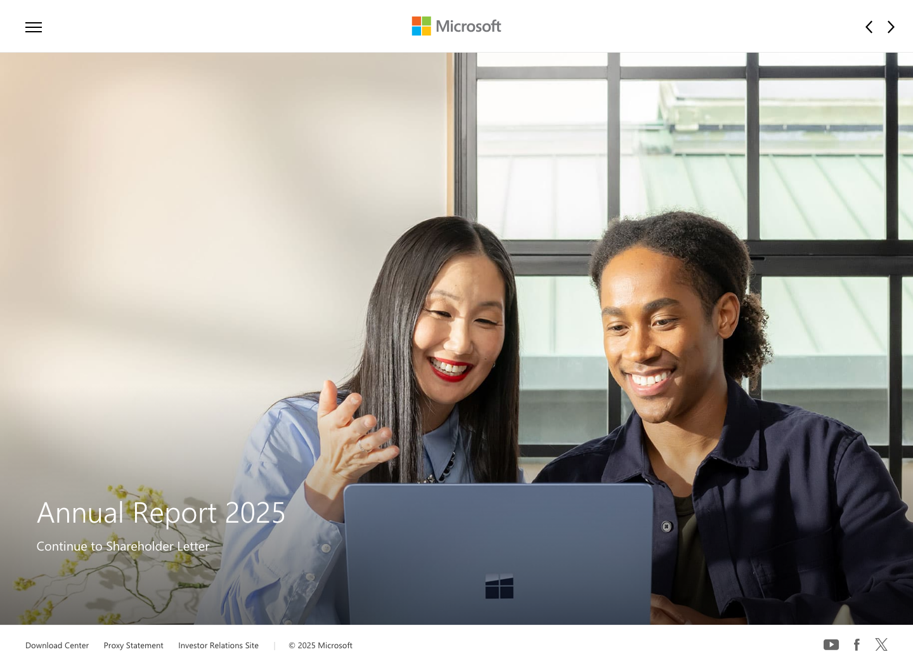
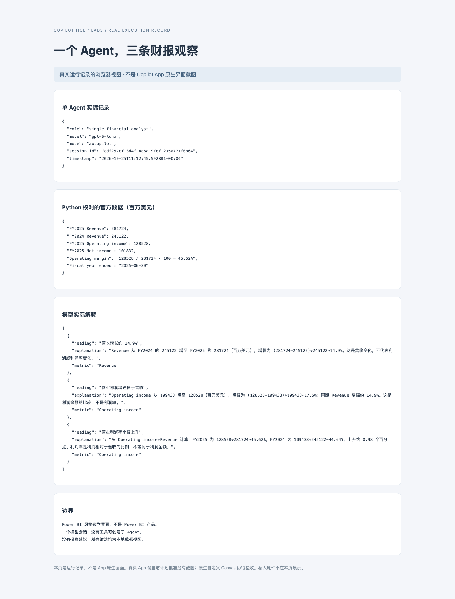
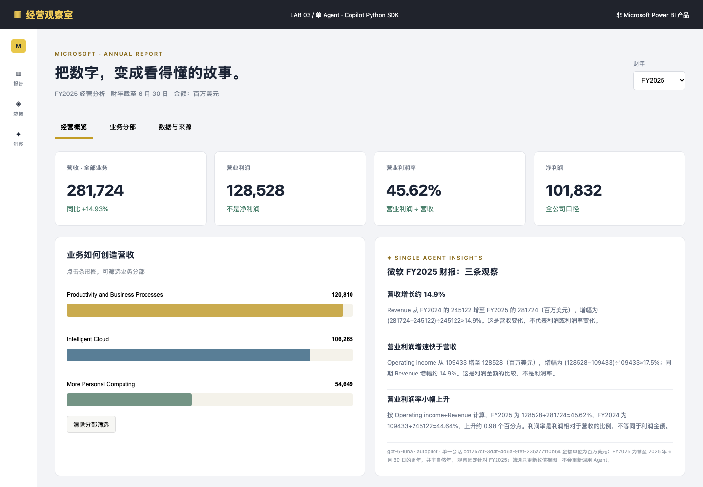
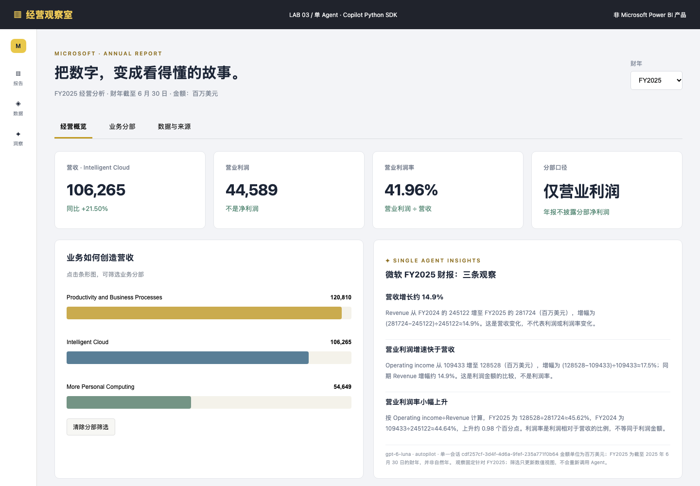
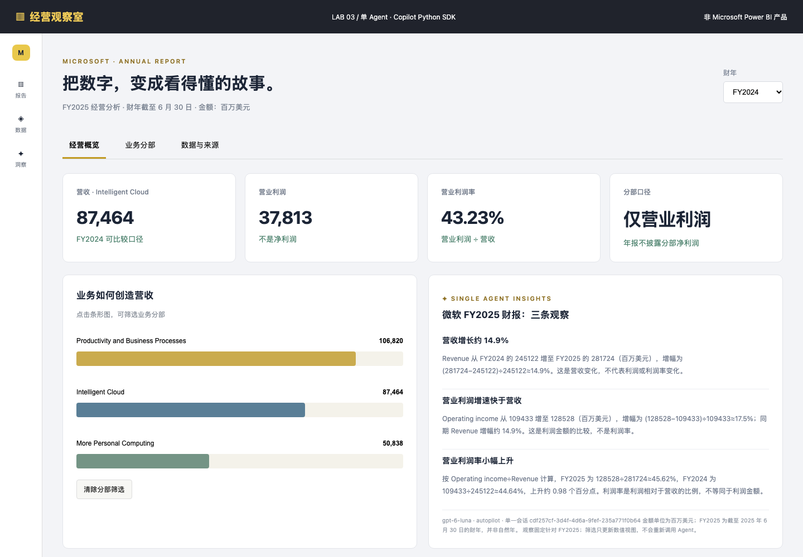
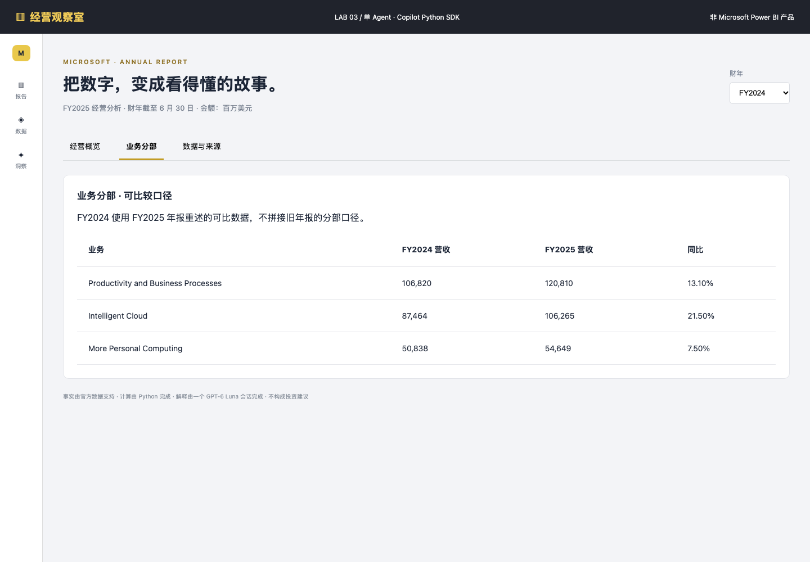
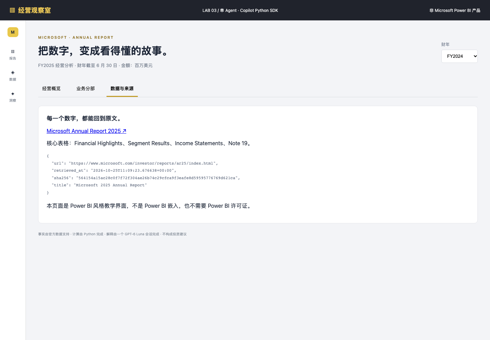

# Lab 3 · 經營觀察室：讓一個 Agent 講清一份財報

本文件使用繁體中文；課程程式、介面與教學截圖沿用原版，畫面文字可能為簡體中文，請對照實際介面操作。

[簡體中文](README.md) | [繁體中文](README.traditional.md)

**故事：** 產品短片做完了，同事問：“微軟的業務到底怎麼樣？”你不想把整份年報複製到聊天視窗，也不想憑模型印象回答。你要做一個像 Power BI 一樣易讀的經營觀察室，讓每個數字都能回到原文。

預計 **45 分鐘**。**本 Lab 保留 Power BI 風格介面**，使用 Python Copilot SDK 的**一個 Agent**分析，不使用多 Agent，不用 HyperFrames 替換介面。模型是 **GPT-6 Luna**，模式是 **Autopilot**。

所有命令在課程根目錄執行，先啟用 Python 環境。頁面只是教學作品，不是 Power BI 服務，也不需要 Power BI 許可證。

## 步驟 1 · 先確認“講的是哪一年、什麼口徑”

開啟指定的 [Microsoft Annual Report 2025](https://www.microsoft.com/investor/reports/ar25/index.html)。

找到 Financial Highlights、Income Statements 和 Segment Results / Note 19。FY2025 是**截至 2025 年 6 月 30 日的財年**，不是 2025 自然年；表格金額通常為**百萬美元**，不要混成美元、億元或十億美元。

```bash
python tools/fetch_sources.py
python Lab3/Code/finance.py
```

第一條從官方頁面提取相關表格並儲存來源資訊，第二條列印 Python 解析結果。已經隨課程附帶本次實際獲取的表格快照，斷網時可先檢視；如果重新抓取失敗，不用假資料覆蓋快照。

**檢查：** FY2025 營收 `281724`、營業利潤 `128528`、淨利潤 `101832`，單位均為百萬美元。2024 分部對比採用本份 2025 年報列示的重述資料。



## 步驟 2 · 在 App 規定“一個 Agent 就夠了”

新建本地會話，開啟課程根目錄，選擇 **GPT-6 Luna** 與 **Autopilot**。傳送：

```text
只修改 Lab3/Code。為非財務背景同事製作一個 Power BI 風格的微軟 FY2025 財報觀察室。
業務程式碼統一 Python，使用 Python GitHub Copilot SDK。
只允許一個分析 Agent；不要建立子 Agent，不使用 fleet。
資料只來自 https://www.microsoft.com/investor/reports/ar25/index.html。
用 Python 核對營收、營業利潤、淨利潤、營業利潤率與三個業務分部之和。
模型只解釋提供的資料，不自行上網補數字，不給投資建議。
頁面要有經營概覽、分部檢視、財年篩選、點擊分部篩選和資料來源。
請實際執行並用 Playwright 核對，而不是只給設計圖。
```

**檢查：** App 設定正確。這裡“用一個 Agent”不是只在介面寫一個頭像；參考程式碼通過僅提供完成任務工具、禁止子 Agent 工具來限制分析會話。

第一張是課程公共的**真實 App 設定截圖**，與 Lab 1 使用同一次設定拍攝，不宣稱是另一個已執行的分析會話；第二張是本 Lab 獨立的 SDK 會話證據。




## 步驟 3 · 讓 Python 計算，讓 Agent 解釋

```bash
python Lab3/Code/analyze.py
```

程式讀取官方資料，先在 Python 中計算營業利潤率，再給唯一的分析會話提交事實和結構化輸出約束。

**檢查：** `Code/output/analysis.json` 有恰好三條觀察，以及 `trace.model = gpt-6-luna`、`trace.mode = autopilot` 和一個會話 ID。事件中的 `agent_id` 不應出現子 Agent。

模型措辭可以不同；下面兩點必須一致：不能把營業利潤當成淨利潤，不能把利潤率的變化當成營收增長率。按精確資料算出的同比百分比與官網取整百分比略有差異，不代表資料錯誤。


## 步驟 4 · 開啟經營概覽，不先堆一整頁表格

```bash
python Lab3/Code/app.py
```

保持終端開啟，訪問：

```text
http://127.0.0.1:8013/
```

看到營收、營業利潤、營業利潤率和淨利潤四張卡片，以及三個業務分部條形圖和 Agent 觀察。先用自己的話向同事解釋：“營收是做了多少生意，營業利潤是在經營層面剩下多少，利潤率是兩者的比例。”

**檢查：** 全部業務 / FY2025 下營收 `281,724`，營業利潤率約 `45.62%`，淨利潤 `101,832`。不應出現載入錯誤。



## 步驟 5 · 點擊一項業務，讓數字跟著問題變化

點擊 **Intelligent Cloud** 條形圖。

**檢查：** 營收卡片變為 `106,265`；利潤卡片改為該分部營業利潤，利潤率同步重算。淨利潤位置不偽造分部淨利潤，而是明確提示“僅營業利潤”口徑。

右側 Agent 文字仍是針對 FY2025 全公司的三條觀察，頁面已註明：**篩選只更新資料檢視，不會自動重新呼叫 Agent**。不能讓固定解讀看起來像剛剛針對篩選條件重新分析。



## 步驟 6 · 換一個財年，別把兩個口徑拼在一起

保留 Intelligent Cloud 選擇，把右上財年切為 **FY2024**。

**檢查：** 雲業務營收為 `87,464`。由於本課程沒有提供可直接比較的 FY2023 分部同比卡片，FY2024 卡片不會編造同比增長率。

點擊 **清除分部篩選** 可以回到全部業務，再切回 FY2025。



## 步驟 7 · 切換檢視，讓同一份資料回答不同問題

點擊頂部 **業務分部**。

**檢查：** 表中出現三個分部，FY2024 / FY2025 數值和同比一目瞭然。三項 FY2025 營收相加為 `281,724`。這些是資料檢視，不是新增的三個 Agent。

```bash
python -m pytest -q tests/test_labs.py -k "financial or single_agent"
```



## 步驟 8 · 最後給來源，而不是只給一句“相信 AI”

點擊 **資料與來源**，檢視原文連結、獲取時間和 `sha256`。開啟連結回到年報核對；雜湊用於識別本次抓取內容，不是對未來網站內容永遠不變的保證。

**檢查：** 來源確實是 Microsoft Annual Report 2025，沒有混入舊年報、股價網站或模型自編數字。頁面標明非投資建議與非 Power BI 產品。



完成後按 `Ctrl+C` 停止服務。

**交付檔案：** `Code/finance.py`、`Code/analyze.py`、`Code/output/analysis.json`、`Code/data/`、網頁程式碼與本目錄截圖。頁面、模型和資料三個環節都要通過，不能只完成一個漂亮介面就算驗收。
